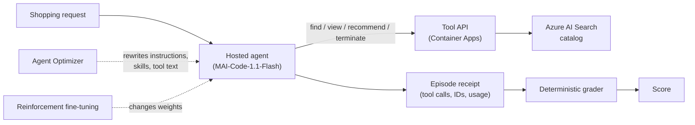
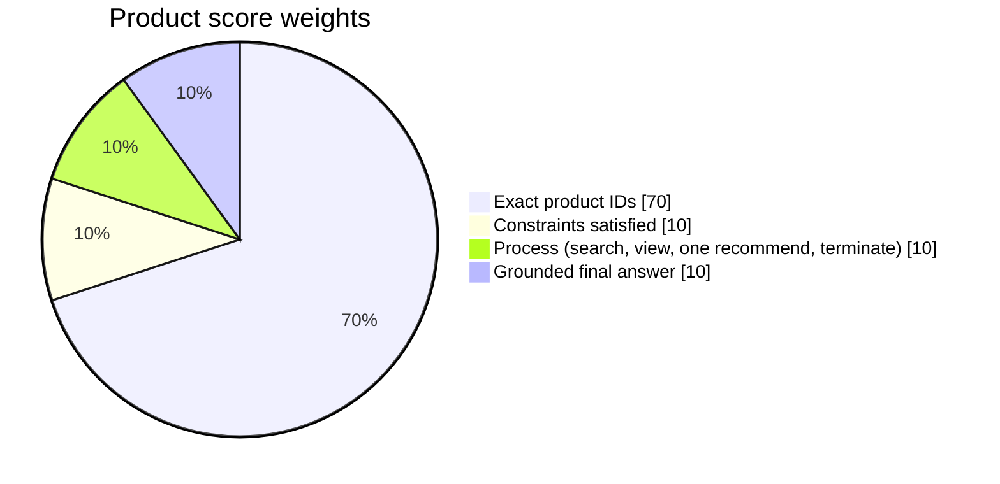
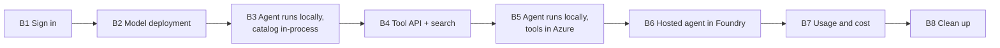
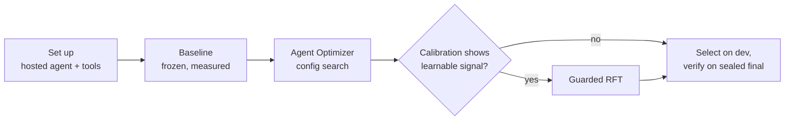

# Walkthrough: validate the current repo and demo

This guide walks you through what the repo already contains, before any workshop
content is built. It has three parts:

- **Part A: local.** No Azure needed. Confirms the code, data, grader, and
  published results reproduce on your machine.
- **Part B: your Foundry project.** Deploys the tool API and one hosted agent,
  runs real episodes, and checks token usage and cost.
- **Part C: the MAI-agent-hillclimb skill.** The reusable method this repo
  demonstrates, packaged so you can apply it to any agent.

Each step answers one question, gives the commands, says what you should see, and
has a checkbox so you can track progress.

> All commands are bash and run from the repo root inside the devcontainer. The
> repo's own docs use PowerShell; the commands here are the bash equivalents.

## The big picture



The story: a base agent scores poorly, mostly because it doesn't finish the job
properly. **Agent Optimizer** fixes a lot of that without touching the model.
**RFT** helps further only where calibration shows there is something to learn.
Every claim is backed by saved per-episode receipts.

## Where things live

| Folder | What to look for |
|---|---|
| [agents/](../../agents) | `<task>/baseline` vs `<task>/optimized` configs; `shared/baseline_runtime.py` vs `shared/runtime.py` |
| [src/shoppingbench_foundry/](../../src/shoppingbench_foundry) | `grading.py` (the score), `store.py` (catalog), `app.py` (tool API) |
| [data/](../../data) | Frozen benchmark rows and the generated catalog (`prepared/search-documents.jsonl`) |
| [evals/](../../evals) | Datasets by role, evaluation scripts, saved receipts under `results/` |
| [optimize/](../../optimize) | Agent Optimizer runner and seed configs |
| [rft/](../../rft) | RFT data, calibration, submission, job receipts and training curves |
| [azure/](../../azure) | Bicep for the tool API, search, registry, storage |
| [.github/skills/mai-agent-hillclimb/](../skills/mai-agent-hillclimb) | The reusable skill (Part C) |

---

## Part A: local (no Azure)

### A1. Is my environment ready?

The devcontainer's setup script creates `.venv`, installs the project with
`[agents,dev]` extras, and registers a Jupyter kernel. Confirm it worked:

```bash
source .venv/bin/activate
python --version
python -m pytest
ruff check .
```

**You should see:** Python 3.12, all tests passing, and no lint errors.

> Not in the devcontainer? Run `python -m venv .venv && source .venv/bin/activate && pip install -e ".[agents,dev]" -r .devcontainer/requirements.txt`.

- [ ] Tests and lint pass

### A2. Is the data really deterministic?

Everything downstream depends on the catalog and the dataset splits. Regenerate
them and confirm nothing changed:

```bash
python data/scripts/prepare.py
python rft/scripts/prepare_data.py
git diff --exit-code -- data/prepared evals/datasets rft/data && echo "No drift"
```

**You should see:** split counts printed, then `No drift`. Per task: 30
development cases and 50 sealed final-test cases.

- [ ] Regenerated data matches what's committed

### A3. What does one task look like?

```bash
python - <<'PY'
import json
case = json.loads(open("evals/datasets/development/product.jsonl").readline())
print("Query:  ", case["query"])
print("Answer: ", json.dumps(case["item"]["reward"], indent=2)[:600])
print("\nSplits:", json.dumps(json.load(open("evals/datasets/manifest.json")), indent=1)[:800])
PY
```

**Notice:** the correct answer is an exact product ID plus the constraints it
must satisfy (price, attributes, service). A fluent answer isn't enough.

- [ ] I can read a task and its correct answer

### A4. How hard is it to pick the right product?

Each correct product has a **decoy** that breaks one constraint. Search the
catalog the same way the agent does:

```bash
python - <<'PY'
import json
from shoppingbench_foundry.store import InMemoryProductStore

store = InMemoryProductStore(
    json.loads(line)["product"] for line in open("data/prepared/search-documents.jsonl")
)
case = json.loads(open("evals/datasets/development/product.jsonl").readline())
gold = case["item"]["reward"]["product_id"]

print("Query:", case["query"], "\n")
print("find_product('chili powder', price='375-'):")
for p in store.search("chili powder", 1, price="375-"):
    print(f"  {p['product_id']:>20}  {p['price']:>8}  {p['title'][:60]}")

print("\nGold vs decoy:")
for p in store.get_products([gold, f"decoy-{gold}"]):
    print(f"  {p['product_id']:>20}  {p['price']:>8}  {p.get('attributes')}")
PY
```

**Try:** change the search words or drop the price filter. How often would you
pick the decoy by accident?

- [ ] I've seen a gold product next to its decoy

### A5. How is an episode scored?

Open [grading.py](../../src/shoppingbench_foundry/grading.py) at `grade_sample`.
For Product:



Re-grade real baseline episodes from disk:

```bash
python - <<'PY'
import json
from shoppingbench_foundry.grading import grade_sample
from shoppingbench_foundry.store import InMemoryProductStore

store = InMemoryProductStore(
    json.loads(line)["product"] for line in open("data/prepared/search-documents.jsonl")
)
items = {
    row["name"]: row["item"]
    for row in map(json.loads, open("evals/datasets/development/product.jsonl"))
}
for receipt in map(json.loads, list(open("evals/results/baseline/product.jsonl"))[:6]):
    case = receipt["name"].rsplit("-rollout", 1)[0]
    grade = grade_sample(receipt["sample"], items[case], store)
    calls = [c["function"]["name"] for c in receipt["sample"]["output_tools"]]
    print(f"{receipt['name']:<24} score={grade['score']:<6} calls={calls}")
    print(f"{'':<24} process={grade['process_components']}\n")
PY
```

**You should see:**

- `product-002-rollout-1` scores **0.875**. It found the right product but never
  called `terminate`.
- `product-005-rollout-2` scores **0.025**. It kept viewing products and never
  recommended anything.

Most baseline losses look like this: unfinished behavior, not wrong knowledge.

- [ ] I can explain why each of those two episodes lost points

### A6. What actually changed between baseline and optimized?

```bash
diff -ru agents/product/baseline agents/product/optimized | less
```

Then compare the two runtimes:

| | [baseline_runtime.py](../../agents/shared/baseline_runtime.py) | [runtime.py](../../agents/shared/runtime.py) |
|---|---|---|
| Max tool steps | 30 | 12 |
| Must call a tool | No | Yes (one at a time) |
| After `recommend_product` | Anything | Only `terminate` |
| Final answer | Whatever the model said | Separate grounded-answer turn |

- [ ] I can name the instruction and runtime changes that fix the A5 failures

### A7. Do the published numbers reproduce?

```bash
python evals/scripts/build_release_summary.py
git diff --exit-code -- evals/results/summary.json && echo "Summary reproduces"

python evals/scripts/compare_model_costs.py --check

mkdir -p .foundry/results
python evals/scripts/summarize_development.py \
  --baseline evals/results/baseline/product.jsonl \
  --candidate evals/results/optimized/product.jsonl \
  --output .foundry/results/product-comparison.json
```

**You should see:** `Summary reproduces`, the cost check passing, and a Product
comparison of about **0.753 → 0.941** with a confidence interval. The interval
is case-clustered: three rollouts of the same case aren't treated as
independent evidence.

- [ ] Summary and cost table reproduce
- [ ] I've seen a paired comparison with a confidence interval

### A8. What evidence exists for Agent Optimizer and RFT?

```bash
ls evals/results/comparisons/
python -m json.tool evals/results/comparisons/web-search-optimized-to-rft.json | head -40
python -m json.tool rft/jobs/web-search-v6/training-curve.json | head -40
```

Things to notice:

- **Selection discipline:** checkpoints are picked on the development split. The
  sealed final test is opened once. Web (live) RFT scored 0.906 there.
- **When RFT is allowed:** calibration needs at least 60 observations, 20
  cases, 3 rollouts per case, and a 25–50% failure rate. See
  [docs/reproducibility.md](../../docs/reproducibility.md).
- **Reward evolution:** the Web (live) graders went v2 → v6
  (`src/shoppingbench_foundry/web_search_rft_grading_v*.py`), each fixing
  something the previous one got wrong.

- [ ] I can find the comparison and training curve behind each RFT claim

### A9. What did the cost comparison actually measure?

Read the cost table in the [README](../../README.md#cost-comparison-with-gpt-56).
Costs come from API-reported tokens at list price, per 1,000 episodes, with
failed episodes kept as zero-score. The [manifest](../../evals/results/model-comparison/manifest.json)
records prices and file hashes.

- [ ] I know what is and isn't included in the cost numbers

---

## Part B: your Foundry project

You'll deploy in stages and confirm each one before moving on:



> **Billing:** B2–B7 make billable model calls and create resources that charge
> while idle (Search, Container Registry). Use the `demo` profile and clean up
> with B8 when done.

### B1. Am I signed in to the right subscription?

```bash
az login --use-device-code
azd auth login --use-device-code
az account show --query "{name:name, id:id}" -o table
```

If needed: `az account set --subscription <subscription-id>`.

- [ ] Correct subscription selected

### B2. Do I have MAI-Code-1.1-Flash deployed?

In your Foundry project, deploy **MAI-Code-1.1-Flash** with the **Global
Standard** deployment type, in `eastus` (or `westus` if `eastus` has no
quota). Use the Foundry portal, the Foundry Toolkit panel in VS Code, or ask
Copilot: *"Use the microsoft-foundry skill to deploy MAI-Code-1.1-Flash
(Global Standard) in my project."*

Then record your settings in a git-ignored `.env`:

```bash
cat > .env <<'ENV'
FOUNDRY_PROJECT_ENDPOINT=https://<resource>.services.ai.azure.com/api/projects/<project>
MAI_OPENAI_BASE_URL=https://<resource>.services.ai.azure.com/api/projects/<project>/openai/v1
MAI_MODEL_DEPLOYMENT_NAME=<your-mai-deployment-name>
ENV
set -a; source .env; set +a
```

Check the deployment answers, signing in with Microsoft Entra (no keys):

```bash
python - <<'PY'
import os
from azure.ai.projects import AIProjectClient
from azure.identity import DefaultAzureCredential

project = AIProjectClient(os.environ["FOUNDRY_PROJECT_ENDPOINT"], DefaultAzureCredential())
print("Deployments:", [d.name for d in project.deployments.list()])

client = project.get_openai_client()
reply = client.responses.create(
    model=os.environ["MAI_MODEL_DEPLOYMENT_NAME"], input="Reply with the single word: ready"
)
print(reply.output_text, reply.usage)
PY
```

**You should see:** your deployment in the list, `ready`, and token usage.
A 403 usually means a missing role on the project (for example, Azure AI User);
a 404 usually means the deployment name is wrong.

- [ ] Model deployment responds

### B3. Can the agent run against my model with the catalog in-process?

This isolates the model from the rest of the stack. The tools run in-process
from the local catalog, so you don't need the tool API yet:

```bash
export SHOPPINGBENCH_TASK=product
export OPTIMIZATION_LOCAL_DIR=product/optimized
export EVALUATION_IN_PROCESS_TOOLS=1
export SHOPPINGBENCH_TOOL_URL=http://unused SHOPPINGBENCH_API_TOKEN=unused

python evals/scripts/evaluate_agent.py \
  --runtime-module agents.shared.runtime \
  --dataset evals/datasets/development/product.jsonl \
  --documents data/prepared/search-documents.jsonl \
  --output ".foundry/results/b3-product-optimized-$(date +%Y%m%d-%H%M%S).jsonl" \
  --limit 3 --rollouts 1 --workers 1
```

Inspect the receipts:

```bash
python - <<'PY'
import glob, json
path = sorted(glob.glob(".foundry/results/b3-product-optimized-*.jsonl"))[-1]
for r in map(json.loads, open(path)):
    calls = [c["function"]["name"] for c in r["sample"]["output_tools"]]
    print(r["name"], r["grade"]["score"], r["usage"], f"{r['latency_seconds']:.1f}s", calls)
PY
```

**Try:** rerun with `--runtime-module agents.shared.baseline_runtime` and
`OPTIMIZATION_LOCAL_DIR=product/baseline`. Do you see the same kind of
failures as in A5?

- [ ] Optimized agent completes episodes on my deployment
- [ ] I've compared baseline vs optimized on a few cases

### B4. Can I deploy the tool API and catalog?

This uses the root `azure.yaml` (Bicep: Search, Container Apps, registry,
storage, managed identity).

```bash
unset EVALUATION_IN_PROCESS_TOOLS
azd env new shoppingbench-demo
azd env set AZURE_LOCATION eastus
azd env set AZURE_SEARCH_LOCATION eastus
azd env set SHOPPINGBENCH_DEPLOYMENT_PROFILE demo
azd env set SHOPPINGBENCH_API_TOKEN "$(openssl rand -hex 32)"
azd provision
azd deploy
```

Load the catalog into Search. You need **Search Service Contributor** and
**Search Index Data Contributor** on the Search service:

```bash
eval "$(azd env get-values)"
python -m shoppingbench_foundry.index_documents \
  --endpoint "$AZURE_SEARCH_ENDPOINT" \
  --documents data/prepared/search-documents.jsonl
```

Smoke-test the API:

```bash
curl -s "$SHOPPINGBENCH_TOOL_URL/health"
curl -s -H "Authorization: Bearer $SHOPPINGBENCH_API_TOKEN" \
  "$SHOPPINGBENCH_TOOL_URL/find_product?q=chili+powder&page=1&price=375-" | python -m json.tool | head -20
```

**You should see:** `{"status":"ok"}` and search results matching what you saw
locally in A4. A 401 means the token doesn't match; an empty list means the
index isn't loaded.

- [ ] Tool API is healthy and returns catalog results

### B5. Does the agent work with tools in Azure?

Same as B3, but the tools now go through the deployed API:

```bash
eval "$(azd env get-values)"
set -a; source .env; set +a
export SHOPPINGBENCH_TASK=product OPTIMIZATION_LOCAL_DIR=product/optimized

python evals/scripts/evaluate_agent.py \
  --runtime-module agents.shared.runtime \
  --dataset evals/datasets/development/product.jsonl \
  --documents data/prepared/search-documents.jsonl \
  --output ".foundry/results/b5-product-optimized-$(date +%Y%m%d-%H%M%S).jsonl" \
  --limit 3 --rollouts 1 --workers 1
```

**You should see:** scores similar to B3. If they differ a lot, compare the tool
results in the receipts. That's a sign the deployed catalog differs from the
local one.

- [ ] Same behavior with remote tools

### B6. Can I deploy and call the hosted agent in Foundry?

This uses [agents/azure.yaml](../../agents/azure.yaml), a separate `azd` project
with five hosted agents. Deploy just Product:

```bash
cd agents
azd extension install azure.ai.agents   # skip if already installed
azd env new shoppingbench-agents
azd env set FOUNDRY_PROJECT_ENDPOINT "$FOUNDRY_PROJECT_ENDPOINT"
azd env set PRODUCT_OPENAI_BASE_URL "$MAI_OPENAI_BASE_URL"
azd env set PRODUCT_MODEL_DEPLOYMENT_NAME "$MAI_MODEL_DEPLOYMENT_NAME"
azd env set SHOPPINGBENCH_TOOL_URL "$SHOPPINGBENCH_TOOL_URL"
azd env set SHOPPINGBENCH_API_TOKEN "$SHOPPINGBENCH_API_TOKEN"
azd deploy shoppingbench-product-agent
cd ..
```

Call it with the Foundry SDK:

```bash
python - <<'PY'
import json, os
from azure.ai.projects import AIProjectClient
from azure.identity import DefaultAzureCredential

project = AIProjectClient(
    os.environ["FOUNDRY_PROJECT_ENDPOINT"], DefaultAzureCredential(), allow_preview=True
)
client = project.get_openai_client(agent_name="shoppingbench-product-agent")
query = json.loads(open("evals/datasets/development/product.jsonl").readline())["query"]
reply = client.responses.create(input=query)
print(reply.output_text)
print(reply.usage)
PY
```

You can also test it in the Foundry portal's agent playground, or with
**Inspect Locally** / **Test in Foundry Portal** from Foundry Canvas in the
GitHub Copilot App.

**If it fails:**

- **Model 401/403 from inside the agent:** the hosted agent's identity needs
  access to the model deployment.
- **Tool errors:** check `SHOPPINGBENCH_TOOL_URL` and the token in the agent's
  `azd` environment.
- **Anything else:** ask Copilot to *"use the microsoft-foundry skill to
  troubleshoot my hosted agent"*. Its `troubleshoot` workflow reads the agent
  logs.

- [ ] Hosted agent deployed
- [ ] Hosted agent returns a grounded recommendation

### B7. What did it cost?

Total the tokens from your B3/B5 receipts and price them at MAI-Code-1.1-Flash
list price ($0.20 input / $1.20 output per 1M tokens):

```bash
python - <<'PY'
import glob, json
rows = [json.loads(l) for p in glob.glob(".foundry/results/b[35]-*.jsonl") for l in open(p)]
inp = sum(r["usage"].get("input_tokens", 0) for r in rows)
out = sum(r["usage"].get("output_tokens", 0) for r in rows)
cost = inp / 1e6 * 0.20 + out / 1e6 * 1.20
print(f"{len(rows)} episodes  input={inp:,}  output={out:,}  cost=${cost:.4f}")
print(f"per 1k episodes: ${cost / max(len(rows), 1) * 1000:.2f}  (published Product optimized: $5.64)")
PY
```

Cross-check against the deployment's usage in the Foundry portal (Monitoring /
Traces for the agent).

- [ ] My per-episode cost is in the same range as the published numbers

### B8. How do I clean up?

This deletes the resources `azd` created. Check the resource list before
confirming:

```bash
(cd agents && azd down)
azd down
```

Your Foundry project and model deployment aren't managed by these `azd`
projects. Remove them in the portal if you no longer need them.

- [ ] Resources removed

---

## Part C: the MAI-agent-hillclimb skill

The repo shows the method on one benchmark. The skill at
[.github/skills/mai-agent-hillclimb/](../skills/mai-agent-hillclimb/SKILL.md)
packages that method so a coding agent can run it on **your** agent and domain.
It doesn't depend on this repo's code or on another Foundry skill.



**What it gives you:**

| Piece | Where |
|---|---|
| Phase guides with exit evidence: setup, baseline/optimize, RFT, select/verify, pricing, troubleshooting | `references/*.md` |
| Executable runbook, including an "existing agent" SDK happy path | `references/runbook.md` |
| Starter hosted agent, grader, evaluator adapter, provisioning templates | `assets/`, `scripts/journey.py scaffold` |
| Offline cost calculator (standard library only, no network) | `scripts/cost_report.py` |
| Project contract template and examples | `references/contract.md`, `examples/` |

**Rules it enforces throughout:**

- approval before billable actions;
- one quality definition across all stages;
- failed episodes kept;
- disjoint optimizer/RFT/dev/final data;
- calibrated rewards;
- trade-offs decided in advance;
- the final test opened once.

### C1. What does the cost report look like?

```bash
python .github/skills/mai-agent-hillclimb/scripts/cost_report.py \
  --receipts .github/skills/mai-agent-hillclimb/examples/episodes.synthetic.jsonl \
  --prices .github/skills/mai-agent-hillclimb/examples/prices.synthetic.json
```

The prices are deliberately synthetic. Look at how it separates complete usage
from missing usage, rather than treating missing usage as zero.

- [ ] Cost report runs offline

### C2. What would it scaffold for a new agent?

```bash
python .github/skills/mai-agent-hillclimb/scripts/journey.py scaffold --output /tmp/my-hillclimb-agent
tree -L 2 /tmp/my-hillclimb-agent
```

Compare the starter to this repo's `agents/` layout: domain hooks, grader, and
`azure.yaml`.

- [ ] I've seen the starter project

### C3. How do I drive it with a coding agent?

In Copilot Chat (agent mode), the skill loads when your request matches it.
Try:

- *"Use the mai-agent-hillclimb skill to plan a baseline evaluation for my
  hosted agent. Don't run anything billable yet."*
- *"Using mai-agent-hillclimb, check whether my calibration results justify
  RFT."*
- *"Compute matched baseline vs optimized cost with the hillclimb cost report."*

It reads the matching phase reference, records a project contract, and stops
for approval before anything billable. Pair it with the `microsoft-foundry`
skill (installed by the devcontainer) for project, model, deploy, and
troubleshooting steps.

- [ ] I've asked Copilot to plan one hill-climb phase with the skill

---

## Done?

If every box is checked, you've confirmed that:

- the data, grader, and published results reproduce locally;
- the agent runs on your own model deployment, with local and remote tools;
- a hosted agent is deployed and answering in your Foundry project;
- your measured cost lines up with the published numbers;
- you know how to apply the same method to your own agent with the skill.
