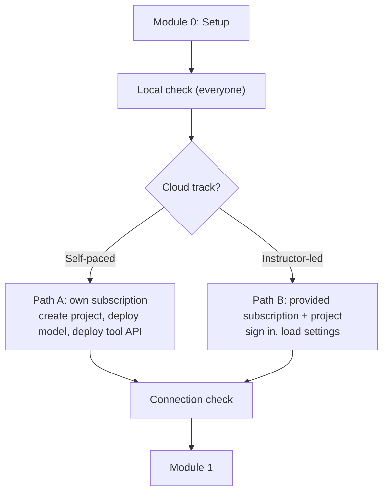
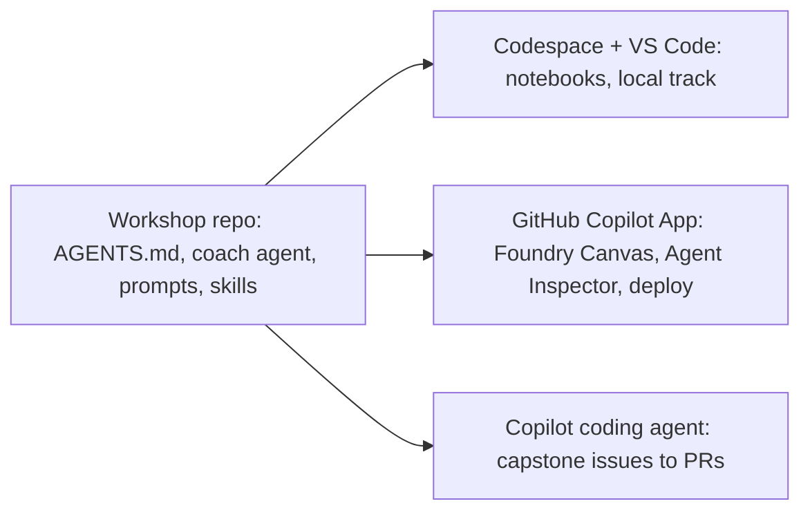

# ShoppingBench hill-climb workshop: plan of action

Status: **planning — not yet implemented.** Build starts on explicit GO.

## 1. Brief

Convert this repo into a workshop under `workshop/` that walks learners through
the hill-climb narrative step by step with a sequence of notebooks.

- **Pedagogy:** constructionism with a debugging methodology. Learners build
  something, see when and why it fails, and fix it to build intuition.
- **Visual storytelling:** prefer diagrams over walls of text, without overdoing it.
- **Voice:** conversational, informative, actionable. No buzzwords or marketing
  language. Learners should feel comfortable exploring with curiosity.
- **Structure:** frame every module and section as a question a developer would
  ask, then answer it.
- **Delivery:** self-paced **and** a half-day instructor-led option.
- **Environment:** a devcontainer that makes everything easy to run in Codespaces.
- **Coding agent:** use Microsoft Foundry skills, Foundry Canvas, and the GitHub
  Copilot App to improve the learner experience.

## 2. Decisions

| Topic | Decision |
|---|---|
| Delivery modes | Self-paced and half-day instructor-led, from one set of notebooks |
| Azure access | One Foundry project per learner, each tied to a unique subscription ID. Self-paced: learner's own subscription. Instructor-led: subscription with a pre-provisioned project |
| Agent Optimizer | Learners run a live job; a completed example run is also provided |
| Format | Notebooks for every module, code-first, aligned with the latest Foundry SDK and API docs |
| Plugin | Workshop plugin lives in this repo |
| Foundry skill install | Foundry Toolkit extension via devcontainer; `npx skills add` as fallback |
| Model / region | MAI-Code-1.1-Flash, Global Standard. Default `eastus`, fallback `westus`; confirm per subscription with a quota check |

## 3. What the repo gives us

- **Mostly offline-capable:**
  - canonical grader (`src/shoppingbench_foundry/grading.py`);
  - in-memory catalog (`InMemoryProductStore`);
  - FastAPI tool API (`app.py`);
  - re-grading saved episodes (`evals/scripts/regrade_receipts.py`);
  - cost scripts (`compare_model_costs.py`, skill `cost_report.py`);
  - most tests.
- **Needs Foundry:** running the agent, Agent Optimizer (`optimize/run.py`),
  RFT (`rft/scripts/`).
- **Real failures to debug:**
  - baseline episodes in `evals/results/baseline/*.jsonl` include episodes
    that never terminated (e.g. score 0.875), ran out of steps (e.g. score 0.025), or picked a
    `decoy-` product;
  - most baseline failures are incomplete behavior, not wrong knowledge.
- **Scoring (Product):** 70% exact selection + 10% constraints + 10% process +
  10% final answer. Shop adds a same-shop check; Voucher adds budget/discount logic.
- **Runtimes:**
  - `agents/shared/baseline_runtime.py`: 30 steps, no protocol enforcement;
  - `agents/shared/runtime.py`: 12 steps, recommend → terminate → final-answer turn.
- **RFT reward v2 → v6:** each version fixed a problem in the previous one
  (e.g. a sudden score drop when an efficiency check flips; v6 adds a cost for
  extra calls and long answers). Good material for "why did this break" exercises.
- **Evaluation contract:**
  - 30-case development split × 3 rollouts for selection;
  - sealed 50-case final test opened once;
  - splits keep connected cases together (no leakage);
  - paired, case-clustered 95% confidence intervals.
- **Gaps to bridge:**
  - README commands are PowerShell; the workshop uses bash;
  - the agent runtime authenticates with `MAI_API_KEY` / `MAI_OPENAI_BASE_URL`;
    notebooks will build that connection from `AIProjectClient` with Entra sign-in
    instead, without changing the existing runtime.

## 4. Module map

Tags: **[core]** half-day path · **[deep]** self-paced extra depth · **[cloud]** needs Foundry.

```mermaid
flowchart LR
  M0[0 Setup] --> M1[1 Be the agent] --> M2[2 How scoring works] --> M3[3 Baseline failures]
  M3 --> M4[4 Fix without retraining] --> M5[5 Is the gain real?]
  M5 --> M6[6 Agent Optimizer] --> M7[7 When is RFT worth it?] --> M8[8 Pick a checkpoint, count the cost]
  M8 --> M9[9 Capstone: your own use case] --> M99[99 Clean up]
```



| # | Question the learner asks | Hands-on work and what breaks | Half-day | Self-paced |
|---|---|---|---|---|
| 0 | Can my environment run this? | Local smoke test; cloud connection check with plain-language errors (403 → missing role, 404 → wrong deployment name); region/quota check | 15m (pre-work if possible) | Full + cloud paths |
| 1 | What does the agent actually have to do? | Start the tool API locally, solve a task by calling tools yourself, notice the decoy. Diagram of one episode | 25m | + Shop task |
| 2 | How is an episode scored? | Build trajectories by hand; recommend without terminating → 0.875; fix. Score-composition diagram | 30m | + Shop/Voucher differences |
| 3 | Why does the baseline fail? | Sort ~10 real baseline failures by cause, plot counts | 30m | + all five tasks |
| – | Break | | 15m | |
| 4 | What can I change without retraining? | Compare baseline vs optimized config/runtime; scripted policy loops forever → hits step limit → fix. [cloud] edit skill, rerun 5 cases; Agent Inspector / Canvas | 30m | + live rerun |
| 5 | How do I know an improvement is real? | Compute paired case-clustered CI from saved runs; leak a case across splits, see the check catch it. Split diagram | 20m | + leakage exercise |
| 6 | What does Agent Optimizer do? | LLM judge proposes, deterministic grader keeps. [cloud] run a live job; compare with the provided completed run | 10m demo / short job | Full live run |
| 7 | When is RFT worth it? | Measure reward variance between runs; rebuild v2 → v6 reward story; design a reward with a cliff, fix it. Decision tree: Optimizer or RFT | 25m | Full story |
| 8 | Which checkpoint should I ship, and what does it cost? | Training curves, Web (static) score-vs-cost trade-off, `cost_report.py`, why the sealed test is opened once | 15m | + model cost comparison |
| 9 | How do I apply this to my own agent? | Start from a Canvas gallery template, apply the `mai-agent-hillclimb` method; improve via issues → coding agent → review PRs against the grader | Take-home | Full |
| 99 | How do I clean up? | `azd down` with explicit confirmation | – | Full |

**Notebook rhythm:**
- section headings are questions;
- exercises follow predict → run → observe → explain → fix;
- at most one diagram per concept;
- collapsed hints, solutions in `workshop/solutions/`;
- self-check cells with plain-language pass/fail;
- "catch up" cell at the top of each notebook for instructor-led sessions;
- shared helpers in `workshop/_lib/` keep cells short.

**Code-first with the Foundry SDK (`azure-ai-projects` 2.x):**
- `AIProjectClient(endpoint, DefaultAzureCredential())`;
- `project_client.get_openai_client()` for Responses, evaluations, files, fine-tuning;
- `allow_preview=True` + `get_openai_client(agent_name=...)` to call a hosted agent;
- `.deployments` to check deployed models;
- Entra ID only, no keys.

## 5. Environment

### Devcontainer (Codespaces)

- Python 3.12; features: Node 18+, Azure CLI, `azd`, GitHub CLI.
- Extensions: Python, Jupyter, Ruff, GitHub Copilot, Foundry Toolkit
  (includes the Foundry skill and Agent Inspector).
- `.vscode/mcp.json` → Foundry MCP server (`https://mcp.ai.azure.com`).
- `.vscode/launch.json` → local tool API, Agent Inspector (F5).
- Forward port 8000 for the local tool API.
- Setup script (post-create):
  - venv, `pip install -e ".[agents,dev]"`, plus Jupyter, `ipykernel`, pandas,
    matplotlib, `azure-ai-projects`;
  - register kernel, run `data/scripts/prepare.py`, quick self-check;
  - fallback: `npx skills add https://github.com/microsoft/azure-skills --skill microsoft-foundry`.
- Codespaces secrets only for self-paced cloud settings; no keys in files.

### Azure: one project per learner



- **Path A (self-paced, own subscription):**
  1. Prerequisite questions: can I create resources? Is the model available in
     my region? Do I have quota? Do I have RFT access? Backed by the
     `microsoft-foundry` skill's project, model-deployment and quota workflows.
  2. Create the Foundry project (Bicep doesn't create it).
  3. Deploy MAI-Code-1.1-Flash (Global Standard, `eastus` → `westus`).
  4. `azd up` for the tool API and search index (`azure/infra`).
  5. Deploy hosted agents.
  6. Rough cost table per module; RFT optional and billable, with a
     "read the saved runs" alternative.
- **Path B (instructor-led, provided subscription):**
  - learner: `az login`, load provided settings file, run the connection check;
  - RFT is a walkthrough of saved runs (training too slow for half a day).
- **Instructor tooling (`workshop/instructor/`):** loop over a learner list
  with subscription IDs and, per learner:
  - create the project in `eastus`;
  - deploy the model;
  - deploy tool API + search index;
  - assign roles (`Search Index Data Reader`, Foundry project access);
  - write that learner's settings file.
- **Connection check (shared):** identity, roles, model responds, tool API
  reachable, search index populated. Each failure prints cause and fix.
- Notebooks read one set of settings (from `azd env` or the provided file), so
  the same cells work on both paths.

## 6. Coding-agent layer

Three surfaces, one source of instructions, coach agent, and skills:



- **Workshop plugin (in this repo):**
  - workshop coach agent;
  - prompts `/hint`, `/explain-episode`, `/check-my-fix`;
  - `mai-agent-hillclimb` skill;
  - `AGENTS.md` scoped to `workshop/`: tutor mode, Socratic questions, points to
    files, no exercise answers unless asked.
- **VS Code / Codespace:** picked up from `.github/`.
- **GitHub Copilot App** ([docs](https://docs.github.com/en/copilot/concepts/copilot-surfaces/github-copilot-app)):
  - desktop app (Windows, macOS, Linux), all Copilot plans;
  - Projects, parallel sessions (own branch, local or cloud sandbox),
    Plan/Interactive/Autopilot modes, sessions from issues, PR review,
    skills/MCP/instructions, Automations, canvases;
  - repo published as a plugin marketplace with a one-click install link
    (`github.com/copilot/app/launch?...open=ghapp://plugins/marketplace/add?source=<owner>/<repo>`);
  - learners verify installs with `/agent`.
- **Foundry Canvas** ([docs](https://learn.microsoft.com/azure/foundry/agents/concepts/foundry-canvas)):
  - preview; runs inside the Copilot App via the `microsoft-foundry` plugin
    (awesome-copilot marketplace, v1.0.18+ for the prompt gallery);
  - open with `/open-foundry-canvas`;
  - prompt gallery, browse models/toolboxes/tools/skills, **Inspect Locally**
    (Agent Inspector), **Deploy to Foundry**, **Test in Foundry Portal**;
  - hosted-agent changes go through Copilot editing code; local inspection and
    deploy use `azd`.

| Moment | Surface | Why |
|---|---|---|
| Modules 0–8, local track | Codespace notebooks | No install; consistent for everyone |
| Module 4 [cloud]: watch an episode fail, fix it | Copilot App + Canvas (Inspect Locally) or Agent Inspector in VS Code | Step-by-step tool calls make the failure obvious |
| Module 6 [cloud] | Canvas resource browser + `microsoft-foundry` `agent-optimizer` workflow | Shows what the optimizer can and can't change |
| Module 7 [cloud] | `microsoft-foundry` `finetuning` workflow + repo RFT scripts | Grader calibration, training curves |
| Module 9 capstone, start | Copilot App + Canvas gallery | Learners build their own agent |
| Module 9 capstone, improve | Issues → coding agent sessions (Plan mode) → review PRs against the grader | Practice checking agent output with evidence |

- `microsoft-foundry` skill `trace` / `troubleshoot` workflows back the coach's
  debugging prompts on live runs.

## 7. Facilitator notes (to include in `FACILITATOR.md`)

- Half-day timings (~3.5h) from the module table.
- Pre-session checklist: per-learner subscriptions provisioned, quota confirmed,
  roles assigned, dry run with one test learner, Copilot App installed.
- Canvas is preview; screens may change, so notebooks describe what to look for
  rather than rely on screenshots.
- Canvas state-changing buttons are disabled while chat is running.
- If a plugin install doesn't take, close VS Code and Copilot CLI, then retry.

## 8. Planned file layout

```text
.devcontainer/
  devcontainer.json
  post-create.sh
.vscode/
  mcp.json
  launch.json
.github/
  planning/workshop-plan.md
  agents/workshop-coach.agent.md
  prompts/{hint,explain-episode,check-my-fix}.prompt.md
  ISSUE_TEMPLATE/capstone-*.yml
  plugin/ (marketplace manifest)
workshop/
  AGENTS.md
  README.md
  FACILITATOR.md
  00-setup.ipynb … 09-capstone.ipynb, 99-cleanup.ipynb
  _lib/
  solutions/
  optimizer-example/
  instructor/
```

## 9. Build order (after GO)

1. Devcontainer and setup script.
2. Module 0, including region/quota check and both cloud paths.
3. Instructor provisioning script.
4. Modules 1–3. **Pause for style review.**
5. Facilitator guide.
6. Modules 4–9 and 99.
7. Plugin and capstone issue templates.

## 10. To verify during implementation

- **MAI-Code-1.1-Flash Global Standard regions/quota:** the Foundry model lookup
  only returned the on-device variant; check per subscription in Module 0.
- **Foundry skill in Codespaces:** confirm the Foundry Toolkit extension provides
  it; otherwise use the `npx skills add` fallback.
- **Plugin marketplace manifest format** for the Copilot App.
- **Live Agent Optimizer runtime and cost**, to size the half-day slot.
